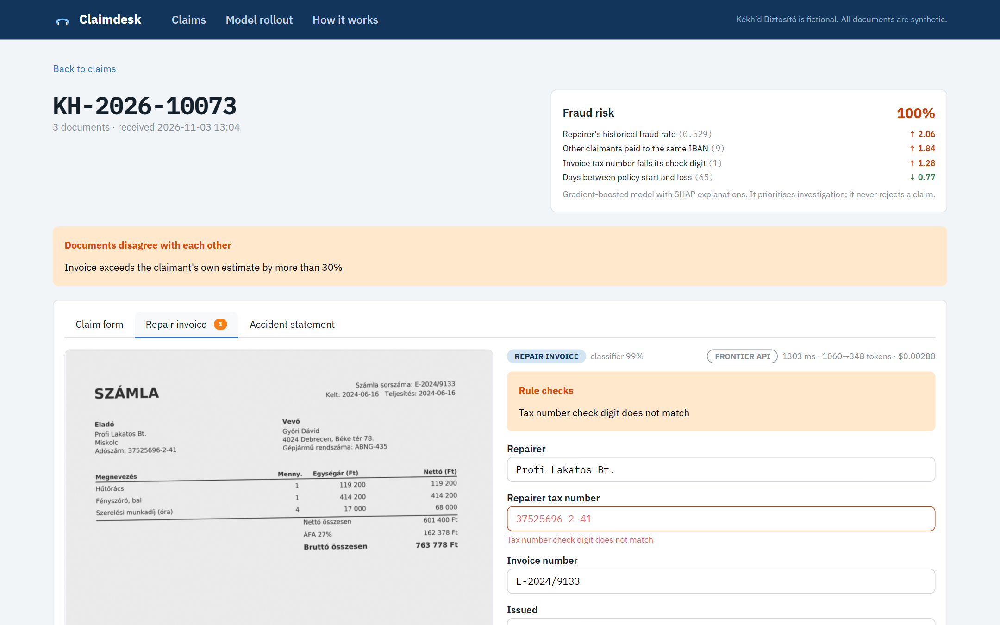
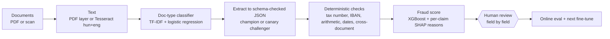

# Claimdesk

**Insurance claims intake where a fine-tuned 4B model beats frontier APIs on accuracy and costs about 46x less per document than Claude Haiku.** The repo includes the MLOps to prove it and roll it back.

**[Live demo](https://d26nm0pan1jz2.cloudfront.net)**: read-only; the canary simulation uses a simulated reviewer, labelled as such in the UI.



Claimdesk is a reference implementation of AI claims intake for a (fictional) Hungarian insurer, Kékhíd Biztosító, with all synthetic data in Hungarian and English. Documents arrive as PDFs or scans, are extracted to schema-checked JSON, checked by deterministic rules, scored for fraud and reviewed field by field by a person. Each review is a label for online evaluation and the next fine-tune.

## What happens to a claim



| Step | Model | What is deterministic |
|---|---|---|
| Text | Tesseract (hun+eng) | PDF text layer used when present; OCR only for scans |
| Classify | TF-IDF char n-grams + logistic regression (MLflow) | Routing; 3 distinct doc types, 100% on test including scans |
| Extract | Champion (frontier API) or canary (fine-tuned Qwen3-4B) | Schema validation; same prompt rules for all frontier models |
| Check | – | Hungarian tax-number check digit, IBAN mod-97, invoice arithmetic, dates, cross-document consistency (plate, buyer, invoice vs estimate) |
| Fraud | XGBoost | Features from documents, mock policy system and claim history; prioritises investigation, never rejects |
| Review | person | Field-by-field; the fraud score only orders the queue |

## Results: a fine-tuned 4B model against frontier APIs

Offline eval on 290 held-out test documents, split by claim (1,026 train / 111 val / 290 test), same prompt rules for all frontier models.

| Model | Fields correct | Docs fully correct | Accident statements | Scans (OCR) | Input tokens/doc | Cost per 1,000 docs |
|---|---|---|---|---|---|---|
| DeepSeek (deepseek-chat) | 97.6% | 79.0% | 88.6% | 93.0% | ~905 | $0.48 |
| Claude Haiku 4.5 (Bedrock, EU inference profile) | 98.4% | 80.7% | 91.4% | 94.9% | ~980 | $2.51 |
| Qwen3-4B-Instruct-2507, untuned (full prompt) | 95.5% | 69.3% | 84.8% | 86.2% | ~963 | (GPU) |
| Qwen3-4B + LoRA v1 (claimdesk-v1) | 99.4% | 95.5% | 96.6% | 97.2% | 377 | $0.055 |

- **Why it wins:** the frontier models' biggest misses are ticked boxes on accident statements, where the text layer interleaves columns and X marks. The fine-tuned model learned the layout. Its prompt is one line, which is why it reads 377 tokens per document instead of about 950.
- **GPU cost assumption:** $0.055 per 1,000 docs assumes one L4 GPU at $0.80/h, 64 concurrent requests and a busy GPU (batch intake; 290 docs in 71 s). The server scales to zero when idle.
- **Synthetic labels:** labels are synthetic ground truth standing in for reviewer-approved extractions. The fraud model's ROC-AUC 0.99 and PR-AUC 0.93 are high because the signals are planted; they prove the pipeline, not real-world fraud performance.

## The model lifecycle

- **Fine-tune:** LoRA r=16 on all linear layers, 2 epochs, lr 2e-4, TRL SFT, bf16, on a Modal L40S; 8.6 minutes over about 1,026 documents.
- **Registry:** MLflow model registry (sqlite) as claimdesk-extractor v1, alias "candidate", with lineage (adapter on a Modal volume).
- **Serving:** vLLM 0.33 on Modal serves the base model and every adapter version side by side (claimdesk-v1, ...). OpenAI-compatible, API key, scales to zero. Rollout and rollback are a routing change, no redeploy. Modal region is us-east; acceptable only because data is synthetic.
- **Canary:** the router sends canary_pct of documents to the challenger. Reviewer field acceptance per model feeds a two-proportion z-test: rollback if z < -2 (minimum 300 reviewed fields per model); promote if not worse (z > -0.5) after at least 900 challenger fields. Auto mode applies the decision. The public demo has reviews read-only so visitors cannot skew stats.

## On AWS

Terraform, eu-central-1, serverless, about €0 to €3 per month.

- CloudFront: `/*` to a private S3 web bucket via origin access control; `/api/*` to a Lambda function URL with a secret origin header.
- API Lambda: FastAPI via Mangum.
- Uploads: SQS, then a worker Lambda (Tesseract + extraction; DLQ; max concurrency 2).
- S3 as the store: claims, files, router state, feedback, published model artifacts.
- Bedrock Claude Haiku 4.5 via EU inference profile, IAM-scoped to that model; challenger key in SSM SecureString.
- $10 budget alert; GitHub Actions OIDC deploy role (main branch only, no stored keys).
- One container image (Python 3.12 + Tesseract) for both functions. Models are published artifacts in S3, no rebuild for a new model.

CI runs ruff, pyright, pytest (deterministic checks), web build, terraform fmt/validate, image build and smoke test. Deploy builds and pushes the image, updates both functions, uploads web and invalidates the CDN.

## Run it locally

Requirements: Python 3.12 and uv, Node, Tesseract with hun.

```bash
cp .env.example .env              # set champion key
cd api && uv sync --all-groups
uv run python -m claimdesk.cli corpus      # renders + OCR, needs Tesseract with hun
uv run python -m claimdesk.cli classifier
uv run python -m claimdesk.cli fraud
uv run python -m claimdesk.evaluate champion
uv run python -m claimdesk.cli seed 24
uv run uvicorn claimdesk.main:app --port 8001

cd web && npm ci && npm run dev   # http://localhost:5174
```

## Fine-tune a new version

```bash
cd api
uv run modal run modal_app.py::finetune --run v2
uv run modal deploy modal_app.py
uv run python -m claimdesk.evaluate claimdesk-v2
```

## What a production deployment would add

- SSO, roles and four-eyes approval on payouts
- Human-labelled training data
- EU or on-prem GPU serving
- DPIA and AI Act documentation (fraud scoring in insurance)
- Document retention rules
- Drift alerts on input layouts and repairers
- Remote Terraform state

## Stack

Python 3.12, FastAPI, Pydantic, scikit-learn, XGBoost, MLflow, Tesseract, Hugging Face TRL/PEFT, vLLM, Modal, Amazon Bedrock, AWS Lambda/SQS/S3/CloudFront, Terraform, GitHub Actions, React 19 + TypeScript + Mantine + TanStack Query.

---

Built by [Attila Hartmann](https://www.linkedin.com/in/attila-hartmann-b7b41a24b), AI engineer in Budapest. See also [Clearline](https://github.com/Attila-Hartmann/clearline) (agentic complaint resolution).
